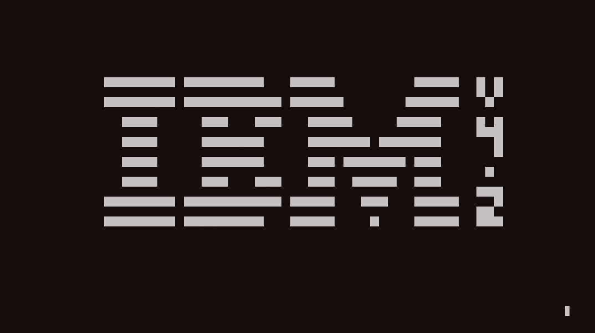

# Chippy

Chippy is a terminal Chip-8 interpreter written in Rust. It was made following Tobias V. I. Langhoff's 
[Guide to making a CHIP-8 emulator](https://tobiasvl.github.io/blog/write-a-chip-8-emulator/#history).
This interpreter is based on the classic Chip-8 of the 1977 COSMAC VIP microcomputer and doesn't support
later Chip-8 variants like CHIP-48 and SUPER-CHIP.



It was tested using the Timendus [Chip-8 Test Suite](https://github.com/Timendus/chip8-test-suite) and
some of the roms in loktar00 [chip8 repository](https://github.com/loktar00/chip8/tree/master).

## Quickstart

Chippy isn't available on package repositories, so you'll have to build it from scratch. You will need :

- Rust 
- Cargo 
- Git

To download it and compile a release binary, you can run :

```bash
git clone https://github.com/eFournierRobert/chippy.git
cd chippy
cargo build --release
cp target/release/chippy .
```

After executing those commands, you will have a binary `chippy`.

## How to use

### Executing

`./chippy -h` or `./chippy --help` should give you the full help screen, but there's only one flag which is `-g`/`--game`.

This **mandatory** flag allows you to specify which rom to execute : `./chippy -g programs/1-chip8-logo.ch8`

You can use Ctrl+C to quit the interpreter.

### Keyboard

The COSMAC VIP keyboard wasn't a full size keyboard. It only had 16 keys (0 to 9, A to F). In Chippy, the keys are
bound this way on the keyboard :

| Physical key | Chip-8 Key |
| --- | --- |
| 1 | 1 | 
| 2 | 2 | 
| 3 | 3 |
| 4 | C |
| Q | 4 | 
| W | 5 | 
| E | 6|
| R | D |
| A | 7  |
| S | 8 |
| D | 9 |
| F | E |
| Z | A | 
| X | 0 |
| C | B |
| V | F |